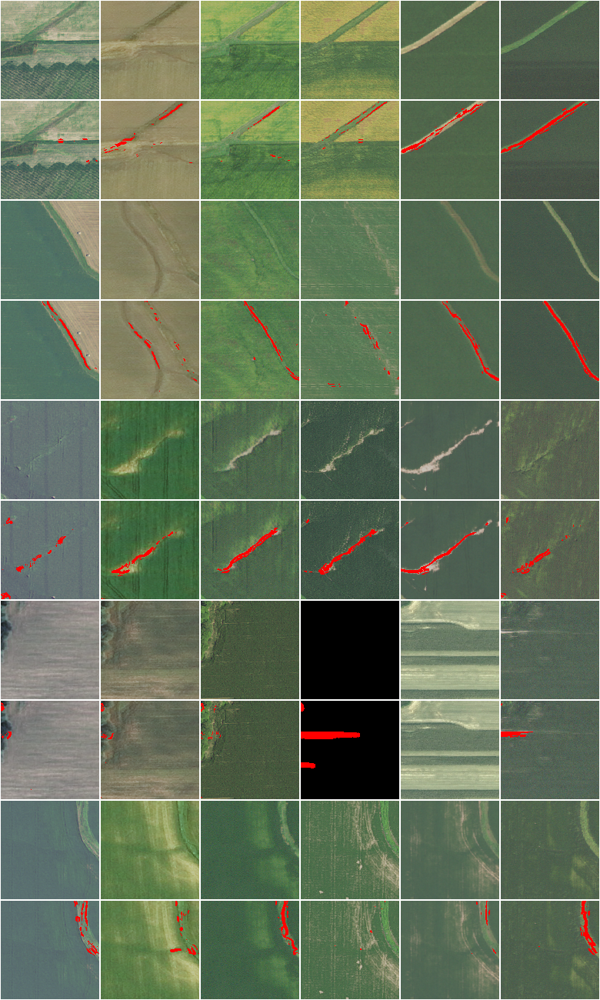

# 12 — Ephemeral-gully weak segmentation (ViGIR EG dataset)

**First results of the ephemeral-gully (EG) branch** ([spec/11](../spec/11-gully-detection.md)), on the ViGIR EG
dataset (Tousi et al., WACV 2025; © ViGIR, used with permission and cited). The dataset has only
**location-level** labels: an EG is present at this location in some year, or not. There is no pixel ground
truth yet, so segmentation is evaluated indirectly, by how well each location's predicted masks detect the
labelled locations. Pixel metrics will follow once annotations exist (decision G9).

## Setup

- **Data:** 621 locations × 6 NAIP acquisitions (128 × 128 RGB, about 1 m/px), plus USGS 3DEP 1 m LiDAR terrain
  for every location.
- **Split:** spatially blocked over 87 geographic clusters of about 2 km. Dev has
  310 locations (177 positive); test has 311
  (177 positive). No cluster is shared between them.
- **Sites and couplings:** all pixels of all 6 years (98,304 per location); orientation-aware 8-neighbour
  spatial couplings plus temporal couplings.
- **Stage 1** (exact): an independent class-conditional label model. Dev negatives are clamped to background,
  and dev positives carry the exact "at least one EG pixel" constraint. Training on all dev took
  305 s.
- **Stage 2:** the structured posterior. MAP by graph cut (exact; the posterior is ferromagnetic); marginals
  by Gibbs sampling started at the MAP state. Test inference took 475 s.
- **Model selection on dev only:** 3-fold cross-validation grouped by geographic cluster (2550 s),
  choosing the LF set, β and τ. Selected: **core LFs (no permanence/vegetation), β = 0.5, τ = 1.0**.

## Location-level detection on test (311 locations; used only for this evaluation)

| score | AUC | best F1 | n |
|---|---|---|---|
| structured_marginal_mass | 0.834 | 0.832 | 311 |
| structured_frac | 0.833 | 0.836 | 311 |
| structured_largest_cc_p0.5 | 0.826 | 0.806 | 311 |
| lf_line_on_flow_pos_frac | 0.826 | 0.824 | 311 |
| independent_marginal_mass | 0.825 | 0.827 | 311 |
| structured_largest_cc | 0.825 | 0.799 | 311 |
| independent_frac | 0.825 | 0.824 | 311 |
| independent_top100_marginal | 0.795 | 0.818 | 311 |
| majority_frac | 0.723 | 0.776 | 311 |
| lf_flow_path_pos_frac | 0.689 | 0.768 | 311 |
| terrain_max_log_acc | 0.684 | 0.778 | 306 |
| structured_top100_marginal | 0.654 | 0.787 | 311 |
| lf_non_crop_pos_frac | 0.500 | 0.725 | 311 |
| lf_straight_line_pos_frac | 0.500 | 0.725 | 311 |
| lf_thin_line_pos_frac | 0.496 | 0.725 | 311 |
| lf_convergence_pos_frac | 0.492 | 0.725 | 311 |

Best F1 is optimistic, because its threshold is chosen on test; read it next to AUC. A constant "all positive"
predictor has F1 = 0.725.

## By region (test AUC)

| region | n | positives | structured largest component | independent | majority vote | LF line_on_flow | terrain alone |
|---|---|---|---|---|---|---|---|
| Iowa | 239 | 136 | 0.859 | 0.868 | 0.725 | 0.867 | 0.716 |
| Missouri/Illinois | 72 | 41 | 0.712 | 0.670 | 0.719 | 0.688 | 0.552 |

## Model selection: dev cross-validation (mean validation AUC of the largest MAP component)

| LF set | β | τ | CV AUC |
|---|---|---|---|
| core LFs (no permanence/vegetation) | 0.500 | 1.000 | 0.570 |
| core LFs (no permanence/vegetation) | 0 | 0.250 | 0.567 |
| core LFs (no permanence/vegetation) | 0 | 1.000 | 0.567 |
| core LFs (no permanence/vegetation) | 0.500 | 0.250 | 0.564 |
| core LFs (no permanence/vegetation) | 1.000 | 0.250 | 0.559 |
| core LFs (no permanence/vegetation) | 1.000 | 1.000 | 0.554 |
| core LFs (no permanence/vegetation) | 2.000 | 0.250 | 0.547 |
| core LFs (no permanence/vegetation) | 2.000 | 1.000 | 0.535 |
| all LFs | 1.000 | 1.000 | 0.503 |
| all LFs | 0.500 | 1.000 | 0.503 |
| all LFs | 2.000 | 0.250 | 0.495 |
| all LFs | 2.000 | 1.000 | 0.491 |
| all LFs | 0.500 | 0.250 | 0.489 |
| all LFs | 1.000 | 0.250 | 0.489 |
| all LFs | 0 | 0.250 | 0.482 |
| all LFs | 0 | 1.000 | 0.482 |

## Ablations on test (MAP-based; one change at a time from the selected model)

| variant | AUC (largest component) | AUC (EG fraction) | locations with non-empty MAP |
|---|---|---|---|
| selected model (core LFs (no permanence/vegetation), β=0.5, τ=1.0) | 0.825 | 0.833 | 0.977 |
| other LF set: all LFs | 0.691 | 0.674 | 0.984 |
| imagery-only LFs (no terrain) | 0.500 | 0.500 | 0 |
| isotropic couplings (no orientation) | 0.825 | 0.838 | 0.977 |
| no temporal coupling (τ = 0) | 0.823 | 0.831 | 0.984 |
| independent model (β = 0) | 0.819 | 0.825 | 0.984 |
| symmetric LFs (no class-conditional ω, ζ) | 0.500 | 0.500 | 0 |
| no MIL constraint | 0.825 | 0.833 | 0.977 |

An AUC of exactly 0.5 with a non-empty fraction of 0 means the MAP mask is empty at every location: the evidence
never overcomes the learned prior that EG pixels are rare. That variant cannot segment at all.

## What stage 1 learned about each LF (all of dev, without pixel labels)

The conditional accuracy of a cast vote is σ(2θ). ω > 0 means the LF votes more often on EG pixels; ζ is the
vote bias.

| LF | α | θ | ω | ζ | coverage |
|---|---|---|---|---|---|
| flow_path | -1.482 | 1.236 | -0.113 | -0.305 | 0.552 |
| convergence | -0.089 | -0.267 | 1.047 | -1.178 | 0.485 |
| line_on_flow | -1.235 | 0.895 | 3.592 | 0.245 | 0.026 |
| thin_line | -0.857 | 1.576 | 0.208 | 0.022 | 0.631 |
| straight_line | -5.098 | 0.873 | 1.731 | -2.936 | 0.048 |
| non_crop | -5.545 | 1.117 | 1.442 | -2.714 | 0.041 |

Learned class bias b = -5.30. This is consistent with EG pixels being rare.

## Examples (test locations; top: image per year, bottom: P(EG) > 0.5 in red)

Locations shown, as (tile, label): [(636, 1), (750, 1), (223, 1), (493, 0), (179, 0)]. These are the three highest-scoring positive and the two
highest-scoring negative test locations.

## Notes

- **Model selection noise.** The mean fold-to-fold standard deviation of the CV AUC is 0.163. Configurations
  whose CV AUCs differ by less than that are not reliably distinguished. In particular, the effect of β (spatial
  smoothing) on *location detection* is not resolved by this data. Its effect on mask shape (continuity across
  gaps and years) can only be measured against pixel annotations.
- **One dev fold is below chance.** Every configuration scores an AUC between 0.26 and 0.32 on one of the three dev folds.
  In that geographic group, the LF evidence ranks negative locations above positive ones. This is the main source
  of the fold-to-fold spread, and the clearest sign that the LFs do not transfer equally across landscapes.
- **The multiple-instance constraint is vacuous at this scale.** Under stage 1, a positive dev location is expected
  to contain a median of 1332 EG pixels, and P(no EG pixel at all) ≤
  10^-2. The constraint "at least one EG pixel among 98,304" therefore barely
  changes the posterior; compare the "no MIL constraint" ablation. An informative location-level constraint would
  need to be stronger, for example "at least one connected component of length ≥ k" or a calibrated count
  likelihood (open question Q20).
- The regions differ markedly: training-free single-LF AUCs are much lower on dev than on test. Cross-validation
  numbers on dev are therefore lower than the test numbers, and they should not be compared directly.
- **What the examples show** (visual inspection, not a metric).
  - The top positives are channels along the DEM flow path. Some of them persist in all six years and look like
    grassed waterways rather than bare ephemeral gullies, which location labels cannot tell apart.
  - The highest-scoring negative (tile 493) has one blank (all-black, no-data) acquisition, and the model marks
    pixels in it. No-data years should be masked out before LFs vote.
- **Pixel-level quality is not measured yet.** Pixel IoU and ±2 px tolerant precision and recall are computed
  automatically once annotations exist (`qws.gully.annotate`; `scripts/gully_export_annotation.py`).
